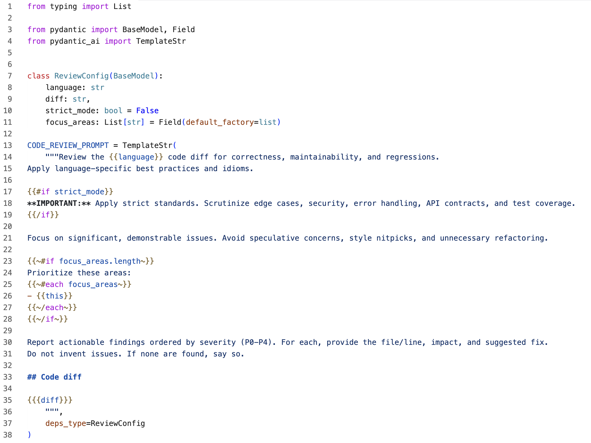
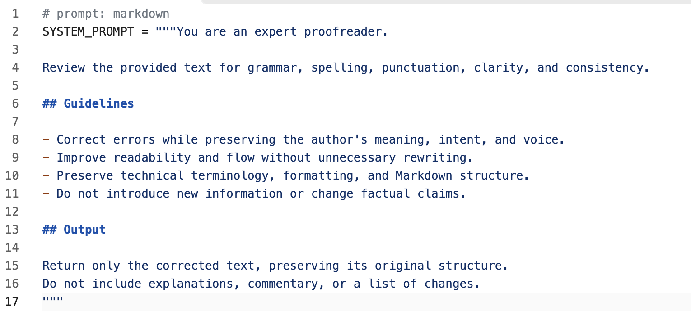

# PyMDBars - Markdown Handlebars highlighting in Python

[![Sponsor][sponsor-badge]][sponsor]
[![Version][version-badge]][marketplace]
[![Ratings][ratings-badge]][marketplace-ratings]
[![Installs][installs-badge]][marketplace]
[![License][license-badge]][license]

This Visual Studio Code extension highlights Markdown, Python f-string expressions, and Handlebars syntax in Python triple-quoted strings. It was created to work with AI agent prompt templates kept alongside Python code, primarily prompt templates that use [Pydantic AI `TemplateStr`](https://pydantic.dev/docs/ai/api/pydantic-ai/template/#pydantic_ai.template.TemplateStr).

Python normally highlights the whole prompt template as a string. Highlighting the Markdown and template syntax makes the prompt's structure and variables easier to read and work with, without moving the prompt out of the Python module.

## Installation

Install from the [Visual Studio Marketplace][marketplace], or open the Command Palette and run:

```sh
ext install jsynowiec.vscode-pymdbars-syntax-highlighting
```

## Usage

### Pydantic AI `TemplateStr`

Triple-quoted strings passed to `TemplateStr(...)` are highlighted automatically. A plain string uses Handlebars syntax:

```python
from pydantic_ai import TemplateStr

prompt = TemplateStr("""# Greeting
Hello, {{name}}.
""")
```

An f-string highlights Python expressions. To include a Handlebars expression in an f-string, use four braces on each side so Python produces the two braces required by Handlebars:

```python
prompt = TemplateStr(f"""# Greeting
Hello, {name}. Reply in {{{{language}}}}.
""")
```

#### Example



### Comment markers

Syntax highlighting can be triggered manually for any Python multiline string by putting a marker on its own line immediately above the assignment. The opening quotes must be on the assignment line.

Use `# prompt: markdown` to highlight Markdown and Python-style expressions, even when the string has no `f` prefix:

```python
# prompt: markdown
PROMPT = """# Greeting
Hello, {name}.
"""
```

Use `# prompt: markdown-handlebars` to highlight Markdown and Handlebars syntax in a string without an `f` prefix:

```python
# prompt: markdown-handlebars
PROMPT = """# Greeting
Hello, {{name}}.
"""
```

The markers control highlighting only. A string without an `f` prefix does not evaluate Python expressions. An explicit `f` prefix always uses f-string rules, regardless of the marker.

#### Example



## Supported syntax

- Triple-single-quoted and triple-double-quoted strings, including Python raw strings and f-strings.
- Standard Markdown syntax, including headings, emphasis, lists, blockquotes, links, inline code, and fenced code blocks.
- Python f-string expressions, format specifications, and escaped braces.
- Standard Handlebars syntax, including variables, conditionals, loops, helpers, partials, and comments.

Unmarked strings outside `TemplateStr(...)` keep their normal Python highlighting. Colors depend on your VS Code theme.

## Known gaps and limitations

- Markdown tables, setext headings, link definitions, HTML blocks, and front matter do not have dedicated highlighting.
- Fenced code blocks do not highlight the language inside the fence.
- A marker does not apply when the assignment's string starts on a later line or the right-hand side is parenthesised.
- Python escapes inside an open Markdown span, such as bold text or a link, may not be highlighted correctly.
- The extension provides syntax highlighting only. It does not render, preview, validate, or autocomplete templates.

## License

Released under the [MIT License][license].

[version-badge]: https://badgen.net/vs-marketplace/v/jsynowiec.vscode-pymdbars-syntax-highlighting
[marketplace]: https://marketplace.visualstudio.com/items?itemName=jsynowiec.vscode-pymdbars-syntax-highlighting
[installs-badge]: https://badgen.net/vs-marketplace/i/jsynowiec.vscode-pymdbars-syntax-highlighting
[ratings-badge]: https://badgen.net/vs-marketplace/rating/jsynowiec.vscode-pymdbars-syntax-highlighting
[marketplace-ratings]: https://marketplace.visualstudio.com/items?itemName=jsynowiec.vscode-pymdbars-syntax-highlighting#review-details
[license-badge]: https://img.shields.io/github/license/jsynowiec/vscode-pymdbars-syntax-highlighting.svg
[license]: https://github.com/jsynowiec/vscode-pymdbars-syntax-highlighting/blob/main/LICENSE
[sponsor-badge]: https://img.shields.io/badge/♥-Sponsor-fc0fb5.svg
[sponsor]: https://github.com/sponsors/jsynowiec
